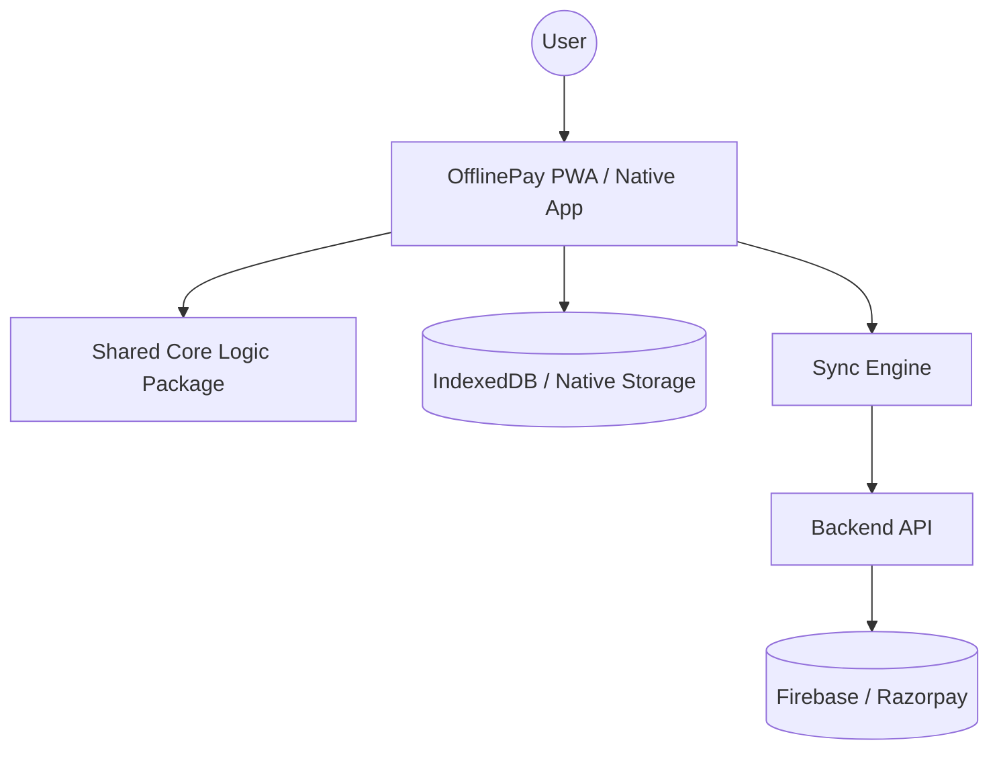
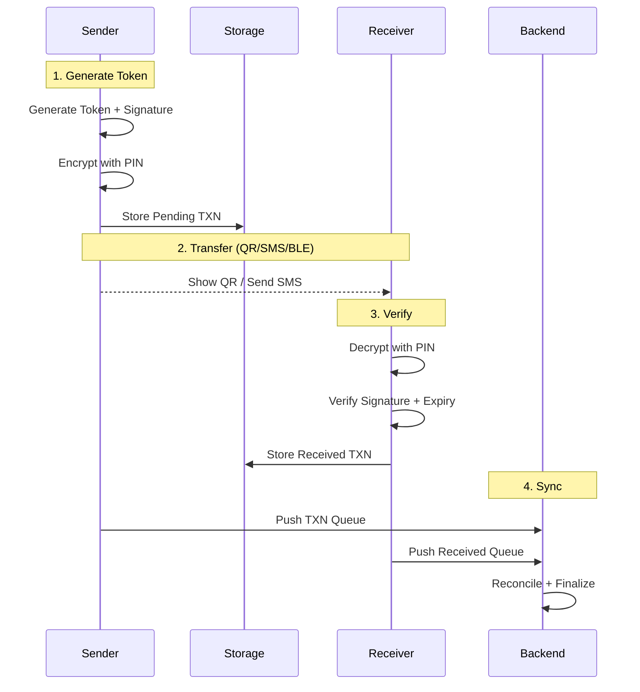

# OfflinePay Architecture

OfflinePay is an offline-first fintech application designed to enable secure digital payments in environments with zero or intermittent connectivity.

## System Design

### High-Level Components

1.  **Client Layer (Web/Mobile)**: React-based PWA and React Native app using `offlinepay-core`.
2.  **Logic Layer (`offlinepay-core`)**: Pure TypeScript library for crypto, trust scoring, and token generation.
3.  **Storage Layer**: IndexedDB for Web, Async Storage for Native. Persists all pending transactions.
4.  **Sync Engine**: Monitors connectivity and executes the reconciliation protocol when online.

## Data Flow: Offline Token Lifecycle

## Component Interaction Flowchart

1.  **Payment Initiation**: User enters amount and recipient.
2.  **Authorization**: User provides PIN → Biometric/PIN verification.
3.  **Cryptographic Proof**: Core package creates signed payload.
4.  **Local Settlement**: Sender's balance is optimistically debited.
5.  **Transmission**: Payload converted to QR/SMS.
6.  **Remote Settlement**: Receiver scans → Logic verifies → Optimistic credit.

## Security Threat Model

### Trust Boundaries
- **Client Trust Boundary**: Everything inside the app vault is encrypted using the user's PIN.
- **Transmission Trust Boundary**: Data leaving the device (QR/SMS) is signed and encrypted; the device fingerprint ensures it cannot be re-used elsewhere.
- **Server Trust Boundary**: The backend is the final authority on balance state; optimistic local updates are rolled back if the server rejects the sync.

### Threat Mapping
| Threat | Mitigation | Implementation |
| :--- | :--- | :--- |
| **Replay Attack** | Unique Transaction IDs | `txnId` uniqueness check against `usedTokens` store |
| **Token Interception** | AES-256 Encryption | PIN-derived keys ensure only authorized parties read data |
| **Tampering** | SHA-256 Signatures | Any bit change invalidates the hash signature |
| **Stolen QR** | Device Fingerprinting | Token tied to `deviceId` generated from hardware specs |
| **Double Spend** | Optimistic Locking | Local balance locked until sync; backend prevents duplicate ID processing |
